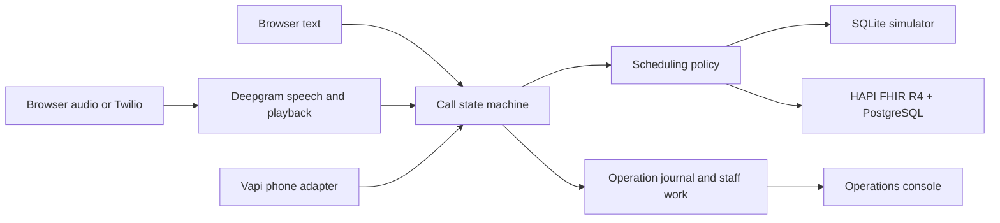

# Switchboard

**A voice front desk for clinic scheduling and routine patient questions.**

Switchboard shows how a clinic can let callers handle routine requests in one conversation. Callers can find an appointment that fits their schedule, change an existing visit, or ask which insurers the clinic accepts. Switchboard checks the calendar as preferences change and confirms the details with the caller before making any appointment change.

When a request needs staff attention, such as a missing referral, Switchboard creates a work item the front desk can follow up on. The Operations console brings those requests, appointment outcomes, and confirmation emails together so staff can see what happened and what still needs action. The demo uses a fictional clinic and synthetic patient records.

[Run locally](#run-locally) · [Try a call](#try-a-call) · [Architecture](#architecture) · [Verification](#verification)

## Run locally

Use Python 3.12, `uv`, and `openssl`. The browser text demo runs on a seeded SQLite calendar and needs no API keys or Docker.

```bash
uv sync --locked --python 3.12
export SWITCHBOARD_OPERATIONS_TOKEN="$(openssl rand -hex 24)"
printf 'Local operations token: %s\n' "$SWITCHBOARD_OPERATIONS_TOKEN"
uv run uvicorn switchboard.api:app --host 127.0.0.1 --port 8765 --ws-max-size 8192
```

Open the [Call Lab](http://127.0.0.1:8765) and select **Start call**. You can type or use **Enable mic** if your browser supports speech recognition. Open [Operations](http://127.0.0.1:8765/operations) in a second tab and paste the token printed in the terminal.

## Try a call

Use your own words in the Call Lab. For a new booking in the local demo, make up a name and a valid date of birth. Switchboard creates the demo patient record when you confirm the booking. Reuse those details on a later call to find your appointment.

- **Book a visit.** Choose a day, time, or location that works for you. You can change your preferences, browse more openings, or pick a slot and confirm it after reviewing the details.
- **Reschedule or cancel.** Return with the same fictional details to move or cancel a booking, subject to the clinic's notice window.
- **Ask about insurance.** Find out which insurers the clinic accepts without giving your identity. Checking patient-specific coverage requires verification and an existing synthetic coverage record.
- **Ask for staff or join the waitlist.** Request the front desk to see a handoff in Operations. Once you have a demo patient record, you can also join the waitlist while looking for an appointment. A matching cancellation or reschedule creates a follow-up task for staff.

Bayview Orthopedics has six fictional doctors across Downtown and Westside. The local calendar covers today and the next 60 days, including weekends. In Operations, staff can filter bookings by date, doctor, and status, open the associated call, and cancel or reschedule eligible visits. Staff reschedules create an updated confirmation in the outbox.

## Architecture



- **Consent is tied to the exact proposal.** The server tracks the pending action and the ID of its read-back. An interruption invalidates the pending playback acknowledgement. A change in scheduling preference releases the prior hold and requires a new selection and confirmation.
- **Concurrent callers compete on the slot version.** A hold persists its owner and expiry on the Slot. Version checks protect the hold and final write. A reschedule cancels the old appointment, releases its slot, and books the replacement in a single transaction.
- **A lost response can be reconciled after restart.** Switchboard journals the operation ID before dispatch. The FHIR transaction commits its receipt alongside the appointment and slot changes. A background worker checks unresolved IDs for receipts and makes their outcomes visible in Operations.
- **A slow calendar lookup leaves the media stream responsive.** The voice loop can process hangups, interruptions, and supported emergency cues while a scheduling turn is in flight. The streaming path clears queued speech on interruption and checks for stale playback acknowledgements.
- **The call timeline records structured events.** Operations shows state transitions, timings, and outcomes. The local synthetic demo can also save new call conversations for seven days with `SWITCHBOARD_STAFF_TRANSCRIPTS=1` and an Operations token. Select **View conversation** to review the transcript and questions. Switchboard stores no call audio. Optional Claude routing helps classify ambiguous intent and extract scheduling preferences. The server validates the result and controls appointment writes.

## Run against HAPI FHIR R4

With Docker Compose, start the same app against an isolated HAPI server backed by PostgreSQL. Compose seeds the fictional clinic before starting the app and waits for readiness.

```bash
export SWITCHBOARD_OPERATIONS_TOKEN="$(openssl rand -hex 24)"
printf 'Local operations token: %s\n' "$SWITCHBOARD_OPERATIONS_TOKEN"
docker compose up --build --wait --wait-timeout 360 app
```

Use the same Call Lab and Operations URLs. Stop the local app first if it is using port 8765. Run `docker compose --profile demo down` to stop the stack and keep its named volumes.

<details>
<summary>FHIR development and clinic settings</summary>

To run Python on the host against the Compose FHIR service, start `docker compose up -d fhir`, export `SWITCHBOARD_FHIR_URL=http://127.0.0.1:8095/fhir`, and run `uv run python -m switchboard.seed --wait 240` before starting Uvicorn. Rerun the seeder to extend FHIR availability. Use a dedicated synthetic instance for the seeder.

Set `SWITCHBOARD_FHIR_REGISTRATION=1` before startup to enable new-patient bookings in the synthetic FHIR store. The transaction creates the Patient and Appointment together. Registration is enabled by default in the SQLite demo.

To try a second clinic, set `SWITCHBOARD_CLINIC_FILE=clinics/lakeside.toml` and use a separate SQLite database or dedicated FHIR instance. The provider roster, accepted payers, locations, and scheduling policies live in [Bayview's configuration](clinics/bayview.toml) and [Lakeside's configuration](clinics/lakeside.toml).

</details>

## Voice and delivery options

| Option | Setup |
| --- | --- |
| **Browser streaming audio** | Set `DEEPGRAM_API_KEY` before starting the app and open the Call Lab on loopback. For a shared demo, set `SWITCHBOARD_BROWSER_AUDIO_TOKEN` to a random value of at least 24 characters and enter it in the Call Lab. Use `SWITCHBOARD_DEEPGRAM_VOICE` to change the default Helena voice. |
| **Vapi phone demo** | Follow the [Vapi setup](docs/vapi.md) for the assistant configuration, test caller allowlist, HTTPS tunnel, and playback callbacks. |
| **Twilio Media Streams** | Set `SWITCHBOARD_PUBLIC_ORIGIN`, `TWILIO_ACCOUNT_SID`, `TWILIO_AUTH_TOKEN`, `DEEPGRAM_API_KEY`, and `SWITCHBOARD_DEMO_CALLERS` (comma-separated E.164 test numbers). Point the inbound voice webhook at `POST /twilio/voice`. Set `SWITCHBOARD_DEMO_STAFF` to enable direct transfer to a test number. Use a Twilio account with Media Streams enabled. |
| **Optional Claude routing** | Set `ANTHROPIC_API_KEY` and `SWITCHBOARD_CLAUDE_MODEL`. To opt in from the browser text simulator, also set `SWITCHBOARD_ENABLE_BROWSER_MODEL=1`. |
| **Confirmation email** | The demo saves confirmations to Operations by default. To deliver to test inboxes, set `SWITCHBOARD_SMTP_HOST`, `SWITCHBOARD_SMTP_FROM`, and `SWITCHBOARD_SMTP_RECIPIENTS` (comma-separated allowlist). The relay must support STARTTLS. The port defaults to 587, with optional `SWITCHBOARD_SMTP_PORT`, `SWITCHBOARD_SMTP_USERNAME`, and `SWITCHBOARD_SMTP_PASSWORD`. |

## Verification

```bash
uv run ruff check .
uv run ruff format --check .
uv run pytest -q
uv run python -m evals.run_text
```

The local test suite passed **64 tests**, with **3 HAPI integration tests skipped**. The text evaluator passed **64 of 64 runs** across 32 authored scenarios and two clinic configurations. It detected **zero violations** in its checks for exact appointment and slot state, patient-scoped reads, the turn authorizing each write, and expected emergency and handoff replies.

With the Docker stack running, verify version conflicts, concurrent holds, transaction rollback, lost responses, and hold expiry against HAPI. The deployment smoke test books a visit through the WebSocket and checks both the operation journal and the resulting FHIR Appointment.

```bash
SWITCHBOARD_TEST_FHIR_URL=http://127.0.0.1:8095/fhir uv run pytest -q tests/test_hapi.py
SWITCHBOARD_FHIR_URL=http://127.0.0.1:8095/fhir uv run python -m evals.smoke_deployment
```

<details>
<summary>Replay streaming audio</summary>

With Deepgram configured, run `uv run python -m evals.replay_audio --scenario booking` against the browser audio endpoint. The replay measures time from the final caller audio frame to the first response frame and time from interrupting speech to the playback clear. Use `--scenario emergency-barge-in` to measure interruption and `--max-barge-ms 300` to enforce a 300 ms budget for that run.

For the signed Twilio adapter replay, use an isolated localhost instance with a Deepgram key and synthetic settings. The replay sends paced audio through the webhook and socket and grades the outcome through the operation journal.

```bash
export SWITCHBOARD_PUBLIC_ORIGIN=https://synthetic-switchboard.example
export TWILIO_ACCOUNT_SID=AC00000000000000000000000000000000
export TWILIO_AUTH_TOKEN="$(openssl rand -hex 32)"
export SWITCHBOARD_DEMO_CALLERS=+14155550101
export SWITCHBOARD_REPLAY_CALLER="$SWITCHBOARD_DEMO_CALLERS"
export SWITCHBOARD_OPERATIONS_TOKEN="$(openssl rand -hex 24)"
replay_data="$(mktemp -d)"
export SWITCHBOARD_DB="$replay_data/switchboard.sqlite"
export SWITCHBOARD_TELEPHONY_DB="$replay_data/telephony.sqlite"

uv run uvicorn switchboard.api:app --port 8765 --ws-max-size 8192 &
demo_pid=$!
trap 'kill "$demo_pid"' EXIT
curl --fail --retry 10 --retry-connrefused --retry-delay 1 http://127.0.0.1:8765/readyz
uv run python -m evals.replay_audio --transport twilio --scenario booking
uv run python -m evals.replay_audio --transport twilio --scenario emergency-barge-in
```

The replay uses Deepgram and a simulated media stream. A telephone-network test requires a separate call.

</details>

Switchboard is designed for synthetic data and supervised demos. The evaluation covers authored workflows. Deployment with real patients requires separate EHR, phone-network, privacy, and clinical workflow validation.

[Architecture and invariants](docs/ARCHITECTURE.md)
