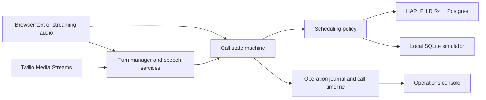

# Architecture

## Scheduling invariants

- The synthetic schedule uses disjoint provider intervals across visit lengths. Every hold updates the exact FHIR Slot version the caller selected. This design assumes one managed Slot per available provider interval and one Slot per appointment.
- Hold ownership and expiry are written in the same FHIR update as the tentative status. The sweeper clears only owned expired holds, with a version precondition. A crash between acquiring a hold and creating a prompt leaves an expiry on the Slot itself.
- A server-owned pending change names the patient, action, existing appointment version when applicable, and held slot. Playback completion is specific to the prompt ID. A change in preference releases the previous hold and requires a new selection and confirmation.
- Confirming a booking or changing an appointment updates every affected resource in a FHIR transaction. Rescheduling cancels the original and creates a replacement in the same transaction. Both cancellation and rescheduling apply the configured notice window.
- The app journals the operation ID before dispatch. A successful FHIR transaction commits the operation receipt alongside the appointment and slot changes. After a timeout, the server checks the receipt and reports an unresolved outcome if it cannot confirm it. The worker can reconcile a late commit after a restart. It rotates through unresolved writes by their persisted last lookup attempt. The console shows recent committed and rejected writes alongside unresolved ones. Receipt lookup bypasses HAPI's search cache. No worker retries the appointment write.
- The demo seed marker is an operational guard. The service still requires an isolated synthetic FHIR instance and an operator-controlled configuration.

## Voice and failure handling

The text and media transports share the conversation state machine. Streaming audio adds Deepgram STT, streamed TTS output, turn endpointing, playback marks, and interruption. A completed mark advances confirmation. On interruption the turn manager invalidates the prompt, cancels TTS output, and clears queued audio. Marks echoed after a clear cannot advance a previous confirmation. Speech onset is compared with the audio position at playback acknowledgement to catch a late speech-start event.

The recognizer waits for the full date of birth or Deepgram's utterance-end event after a partial date. Emergency and staff-request cues bypass that wait. On a recognition disconnect, the call invalidates any pending playback acknowledgement and retries once. It feeds up to 500 ms of recent audio into the new stream, aligns the new stream's timestamps to the call, and ignores results that begin inside the replay. The caller is prompted to repeat and must confirm a fresh read-back. Exhausted retries follow the staff handoff path.

A voice call owns one active scheduling turn. The media loop continues consuming hangup, emergency, staff-request, and recognizer events while that turn is in flight. It cancels and joins the turn on teardown. Cancellation after an authorized FHIR request may leave an unknown outcome. The existing operation journal and receipt worker reconcile that state, and a booked slot remains busy. A slow turn can play a cached cue after 1.5 seconds. Its playback mark is separate from read-back marks and the audio replay excludes it from substantive response latency.

Text and voice use templates for appointment facts. A short affirmation is only a mutation authorization in the pending confirmation state. The phone adapter validates Twilio signatures at the webhook and WebSocket handshake and uses a call-bound one-time ticket. If the stream closes, Twilio fetches the post-stream outcome and selects the relevant end or staff transfer path. A transfer is a direct dial with a recorded attempt and dial-result callback. If the emergency prompt did not complete, the post-stream webhook supplies a Twilio speech fallback.

The emergency detector recognizes a bounded set of cues in finalized speech and plays a self-contained instruction. Recognition depends on the transcript and detector coverage. The clinic has no clinical triage workflow.

## Operations

The demo stores bounded structured call timelines and operation receipts. It retains event names, state transitions, timing, and outcomes. Raw audio, transcript content, member IDs, dates of birth, and caller numbers do not go into the operations database. Text and live audio transcripts are rendered in the current caller session. HAPI stores synthetic scheduling resources separately.

The Docker demo seeds HAPI before starting the app. The seed job publishes the synthetic marker in the last batch, and Compose waits for the app's readiness check. Run the app as a single replica with a writable data directory for its SQLite files. HAPI and Postgres form the separate scheduling backend. `/healthz` reports process liveness and `/readyz` checks the configured synthetic store. Set an operations bearer token for the staff console, and use TLS outside loopback. The operations dashboard reports processing latency for recent turns. The live audio replay reports final caller-frame to first response-frame latency separately.

Protocol references: [FHIR R4 REST and transactions](https://hl7.org/fhir/R4/http.html), [HAPI search caching](https://hapifhir.io/hapi-fhir/docs/server_jpa/configuration.html), [Twilio media messages](https://www.twilio.com/docs/voice/media-streams/websocket-messages), [Deepgram endpointing](https://developers.deepgram.com/docs/endpointing), [Deepgram stream recovery](https://developers.deepgram.com/docs/recovering-from-connection-errors-and-timeouts-when-live-streaming-audio).
